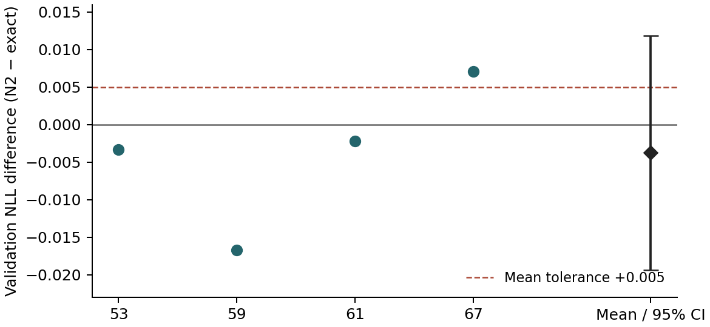
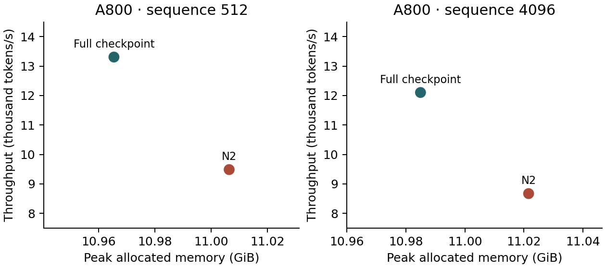

# 有限精度下的可逆训练：残差校正与检查点的取舍

**项目：** 洄（Hui）

**版本：** 英文论文工作稿完整中文译本

**原稿日期：** 2026 年 11 月 4 日

**作者：** WKK 实验室（WKK Lab）

**修订说明：** 本版补入后续分组校正、任务与跨后端记录的审计结果；实验仍为历史记录核查，未新增运行。

> 译稿说明：本文对应英文论文全文，保留其方法、公式、实验结果、局限和参考文献。文中的“检查点”依上下文分别指保存的模型状态和激活检查点技术；“完整检查点”指完整激活检查点方案。本文作为开源项目技术报告工作稿分享，尚未投稿或声称通过同行评审。

## 摘要

可逆块在反向传播时重建激活，但代数上的可逆性并不保证有限精度下能够恢复原始数值。本文研究洄（Hui）：一种采用确定性 INT8 残差校正的混合可逆语言模型实现，并审计其归档中的数值与系统实验依据。在检查点筛选中，我们在 36 个模型检查点上评估四种重建策略，每种策略使用八个验证偏移位置。残差校正策略在全部 36 个检查点上满足筛选所用的保真标准，而未经校正的重建仅通过 24 个检查点。

四组配对实验使用约 13.46 亿参数模型、各训练约 5000 万 token，校正版相对精确反向传播的平均验证负对数似然差为 −0.003759。这些实验满足内部工程容差，但单侧 95% 置信上界为 +0.007777，超过 +0.005 的平均容差，因此尚未建立统计非劣性。此外，在条件匹配的 A800 短时资源探针中，完整激活检查点方案速度更快，峰值已分配显存也略低于残差校正方案。

这些结果支持残差校正作为当前实现中一种有用的数值机制，同时也限制了我们对训练质量、激活显存扩展规律，以及相对检查点方案实际优势的主张。

## 1. 引言

激活存储是神经网络训练的约束之一。激活检查点通过保存边界状态并重算中间计算，可逆块则通过逆运算重建内部状态，两者都可用于缓解这一约束。实际比较取决于数值运算、保存的张量、重算过程、计算内核和测量边界，不能仅由可逆性本身决定。

洄将可逆耦合块与常规 Transformer 层结合起来。其可逆路径无需保留每个分支完整的自动微分计算图，即可重建先前状态。然而，反复相减和重算会引入有限精度误差。我们考察：对重建状态施加一个小型量化校正，能否提高反向传播保真度；以及面对较强的检查点基线，这种校正是否仍然值得采用。

本文的贡献是一份基于具体实现的实证研究，不宣称首次提出可逆 Transformer，也不提出新的收敛定理。我们精确描述保存状态的校正方式，区分直接梯度测量与状态重建诊断，并结合统计不确定性解释训练终点结果。我们还报告了一项系统层面的负结果：相对于未校正可逆路径表现有利，并不意味着优于完整检查点方案。

配套的本地开源候选包含冻结的核心实现、后端适配器、CPU 演示、来源校验和经审计的数值摘要。项目自有代码与文档采用 Apache-2.0；第三方资产保留各自许可与归属说明。

## 2. 相关工作

激活检查点以重算换取存储空间 [1]。RevNet 展示了可逆残差块 [2]，Reformer 则将可逆层用于 Transformer 训练 [3]。这些工作构成洄在架构与显存管理方面的研究背景，本文不将这些思想归为自身贡献。

激活压缩训练也早于本文的校正机制。ActNN 研究低比特激活压缩 [4]，GACT 将激活压缩推广到多种网络架构 [5]。洄保存的是量化后的逆运算残差，而不是直接量化常规反向传播原本需要保存的激活。

逐比特精确可逆 Transformer 已明确利用量化和辅助信息，处理有限精度运算导致的信息丢失 [6]。因此，“保存信息以修复数值可逆性”本身不是本文的新颖性主张。本文方法是近似的，通过直接反向传播对照进行评估，尚未证明逐比特精确。

近期关于逆转语言模型的工作研究了对称动力学、辛动力学，以及面向高效训练与微调的模型转换 [7]；我们的证据尚不能证明洄具备这类转换能力。StreamBP 通过基于序列的分解实现精确反向传播 [8]。我们没有复现该方法，也不对其作数值性能比较。

## 3. 方法

### 3.1 混合可逆计算

设可逆块接收两个流，记为 $x=(x_a,x_b)$。省略参数、归一化细节与位置输入后，耦合计算形式为：

$$
y_b=x_b+\alpha A(N(x_a)),
$$

$$
y_a=x_a+\beta F(N(y_b)),
$$

$$
y=P(y_a,y_b).
$$

其中，$A$ 是注意力分支，$F$ 是前馈分支，$N$ 是归一化操作，$P$ 是可逆的流变换。实现支持恒等变换、交换，以及 Hadamard 式流变换。撤销 $P$ 后，代数逆运算为：

$$
x_a=y_a-\beta F(N(y_b)),
$$

$$
x_b=y_b-\alpha A(N(x_a)).
$$

接受评估的约 13.46 亿参数模型共 24 层，其中包含 18 个可逆层和 6 个常规层。可学习的分支缩放系数是受评估训练配方的一部分。现有证据没有通过仅改变缩放机制的消融实验，单独识别它们的因果贡献。

### 3.2 量化逆运算残差校正

令 $I_0(y)$ 表示前向执行期间进行的一次逆运算。归档实验将校正策略记为 N2。该策略以 FP32 计算残差，并为整个块计算一个缩放系数：

$$
r=\operatorname{FP32}(x)-\operatorname{FP32}(I_0(y)),
$$

$$
s=\frac{\max(\lVert r\rVert_\infty,10^{-12})}{127},
$$

$$
q=\operatorname{clip}_{[-127,127]}\!\left(\operatorname{round}(r/s)\right).
$$

实现保存输出 $y$、INT8 张量 $q$ 和 FP32 标量 $s$。在反向执行期间，它重新计算逆运算 $I_1(y)$，并重建输入：

$$
\widehat{x}=\operatorname{cast}(I_1(y)+sq).
$$

反向路径基于重建状态重新计算各分支。N2 适配器对常规层使用激活检查点。舍入是确定性的；本文不主张该方法能提供无偏梯度估计。

在数值有限、采用最近舍入且没有溢出的条件下，基本量化误差界为：

$$
\lVert sq-r\rVert_\infty\leq s/2.
$$

进一步考虑残差计算、重复逆运算之间的差异，以及最终类型转换，可以得到以下有条件的误差界：

$$
\lVert\widehat{x}-x\rVert_\infty
\leq s/2+\lVert I_1(y)-I_0(y)\rVert_\infty+\rho_r+\rho_{\mathrm{cast}}.
$$

这里，$\rho_r$ 与 $\rho_{\mathrm{cast}}$ 表示数值运算误差项，并非测得的常数。逆运算的确定性十分关键：随机分支或状态变化，可能使“两次逆运算之间差异很小”的前提失效。

这一局部观察不是梯度等价或训练收敛定理。若要讨论局部梯度扰动，还需适当的光滑性，以及固定的传入余切向量，即从后续计算传回的梯度。即使满足这些条件，也不能据此保证全局训练轨迹。

### 3.3 存储与计算方面的影响

当前实现不仅保留残差，还保留每个校正块的输出 $y$。因此，它没有证明激活显存与深度无关，也没有实现可据此宣称的常数级激活显存。

如果存在收益，其来源是相对于选定参考方案，避免保存分支内部的自动微分状态。校正在前向执行期间增加一次逆运算，同时在反向执行期间需要逆运算和分支重算。这种取舍是否有利，必须通过与检查点方案的测量比较来判断，不能仅由 INT8 表示推断。

## 4. 证据与实验设置

本研究根据归档决策记录、各随机种子的终点结果、保真日志和短时资源探针重建证据。本文不将这些历史 GPU 实验描述为此次撰稿时重新运行的实验。数值摘要和图表生成代码随稿提供。历史协议的决策与我们后续的统计解释予以区分。

### 4.1 检查点筛选

三种精确训练配方中，两种采用固定缩放系数，一种采用可学习缩放系数。结合四个随机种子、三个 token 预算——1000 万、2000 万和 5000 万——共得到 36 个模型检查点。

四种重建策略分别在八个验证偏移位置上进行比较，共形成 1152 次“检查点—偏移—策略”比较。这些是一个小规模种子家族内的重复测量，不是 1152 次独立训练实验。

候选策略包括：

- **N1：** 原始逆运算，不作残差校正。
- **N2：** 残差校正。
- **N3 K4：** 每四个可逆层设置一次周期性检查点包装。
- **N4：** 对风险选定层使用 INT8 校正，并每八个可逆层设置检查点包装。

在提供的调度实现中，这些周期性包装没有关闭被包装块内部的重建路径，因此不能把其边界解释为保证精确反向传播的边界。

### 4.2 配对训练

使用随机种子 53、59、61 和 67，在相同前向架构下比较 N2 与精确反向传播参考方案。模型包含 1,346,435,108 个参数，在 WikiText-103 上训练约 5000 万 token，分词采用归档的 DeepSeek tokenizer。

序列长度为 512，batch size 为 8。冻结配方记录的基础学习率为 0.00042，缩放系数学习率为 0.005，预热为 500 步。恢复的源码采用 fused AdamW，betas 为 (0.9, 0.95)，FP32 缩放参数所在组的 weight decay 为 0；预热后使用余弦学习率乘数，最终衰减到各组初始学习率的 0.1 倍。基础参数组未显式指定的设置依赖优化器默认值，完整运行时优化器清单仍需在投稿前补齐。对于这一参数规模，这些属于短程训练。筛选与后续实验共享同一种子家族，因此后续实验不是方法选择之后的独立留出验证。

### 4.3 数值精度的来源依据

恢复的配对训练与筛选构建脚本先以 BF16 构造模型，再将可学习缩放参数的 logits 单独提升为 FP32。Phase D 启动脚本选用的实验臂启用了 FP32 逆运算累加：它提升的是逆运算中的减法精度，不意味着整个注意力或前馈分支都以 FP32 计算。

恢复的 Phase N 筛选则继承精确参考实验臂的默认设置，其 FP32 逆运算累加开关为 false；在筛选运行器和保真测量钩子中没有发现覆盖该开关的代码。这一根据源码恢复的差别，意味着不能把筛选和部署训练视为完全相同的数值配置。上下文阶梯根据 Phase D 检查点的实验配方重建模型。恢复的训练脚本中没有显式的 autocast 上下文。

残差及其缩放系数以 FP32 计算，重建状态再转换回输出数据类型。完整的运行时精度和内核配置核验仍未补齐，尤其是原始 A800 N2 探针；源码设置不能替代这些运行时证明。

### 4.4 反向传播保真度

四个种子各取 11 个探测时点，共形成 44 个保真评估面板。指标包括全局梯度相对 $\ell_2$ 误差、余弦相似度、梯度裁剪后的误差，以及完整 AdamW 参数更新的差异。

四个 token-zero 面板，即尚未消耗训练 token 时的面板，其更新指标仅作观察；更新门槛适用于其余 40 个面板。汇总结果时保留这一差别。

### 4.5 系统比较

在 RTX 5090 上进行的后续吞吐测试，为 N1 与 N2 重新加载同一最终模型和优化器。每个种子进行四次试验，每次先预热 10 步，再对 50 个训练步计时。计时窗口排除验证、检查点写盘和输入传输。

上下文阶梯在序列长度 512、2048 和 4096 下，比较完整检查点、主要采用检查点的 K1 变体，以及 N2；每步均处理 4096 个 token。

另一组 A800 eager 模式探针强制使用 PyTorch Flash SDPA，在长度 512 和 4096 下比较完整检查点与 N2。每个后端、每种长度分别进行三次试验，每次仅对三个训练步计时。这些是资源探针，不是持续训练基准，也不是外部 FlashAttention-2 的实验结果。

## 5. 结果

### 5.1 校正提高了检查点筛选中的通过率

N2 在全部 36 个检查点上通过归档中的保真标准。原始逆运算通过 24 个，N3 K4 通过 25 个，N4 通过 29 个。这支持在本次筛选范围内采用完整残差校正，但能否推广到其他架构和独立选择的种子，仍未得到解决。

在 44 个后续面板中：

- 全局梯度相对误差的面板中位数，最大为 0.007442。
- 单个 batch 的全局梯度相对误差，最大为 0.010678。
- 余弦相似度的面板中位数，最小为 0.999972。
- 梯度裁剪后的相对误差，最大为 0.008896。

所有记录的梯度面板均满足相应工程门槛。在适用 AdamW 更新门槛的 40 个面板中，更新误差中位数的最大值为 0.002599。四个仅作观察的 token-zero 面板，其更新误差中位数则约为 0.05636 至 0.05761。因此，不能将适用门槛的面板中较小的更新误差，推广到优化器初始化阶段。

状态往返重建诊断与直接梯度测量回答的是不同问题。仅有状态偏差不能证明训练更新受到有害影响，较小的梯度偏差也不保证长期优化轨迹一致。因此，我们将训练终点结果视为另一层独立的证据。

### 5.2 训练终点满足工程容差，但尚未建立统计非劣性

**表 1：约 5000 万训练 token 后的配对验证终点。** 差值为 N2 减去精确参考，负值有利于 N2。精确参考使用相同的前向架构。

| 随机种子 | 精确参考 NLL | N2 NLL | N2 − 精确参考 |
| --- | ---: | ---: | ---: |
| 53 | 3.320031 | 3.316741 | −0.003291 |
| 59 | 3.368027 | 3.351332 | −0.016695 |
| 61 | 3.342720 | 3.340552 | −0.002168 |
| 67 | 3.372688 | 3.379804 | +0.007116 |
| **平均** | **3.350867** | **3.347107** | **−0.003759** |

内部工程规则要求平均差值不大于 +0.005，且任何种子的差值不大于 +0.010。表 1 同时满足这两项条件。四个配对差值中有三个为负，平均值为 −0.003759。

这些容差不是置信界。根据四组配对种子，差值的样本标准差为 0.009804，双侧 95% Student-t 置信区间为：

$$
[-0.019360,\ +0.011841].
$$

单侧 95% 上界为 +0.007777，超过 +0.005 的平均容差。因此，即使接受配对 t 推断的假设，现有运行也没有在该界值下建立非劣性。该区间同样没有建立优越性。

仅有四个种子，其分布假设与估计精度都是重要限制。历史工程决策应理解为特定范围内的工程验收，不能解释为统计等价结果。



*图 1：各配对终点差值，以及均值的双侧 95% t 置信区间。虚线表示平均差值的工程容差，不是单个种子的验收阈值。图内英文标注沿用原稿。*

### 5.3 相对原始逆运算有利，不等于解决了与检查点方案的比较

原连续运行的吞吐结论为证据不足：最不利的 N2/N1 吞吐比约为 0.654，但测量区间包含了不同的 I/O 开销。后续匹配计时窗口的测试中，各种子的中位数吞吐比介于 0.8418 和 0.8429 之间。这解决了相对原始逆运算的一项具体计时不一致问题，但不意味着优于完整检查点，也不抹去原始判定。

同样，显存数据需要匹配测量窗口。可学习缩放系数的精确参考方案，在检查点筛选中的峰值已分配显存平均为 20.609 GiB；N2 连续训练记录约为 11.706 GiB。虽然差异很大，但这些测量来自不同执行窗口，我们不将这一比较作为决定性的资源结论。

此外，预留显存和设备层面的使用量高于已分配显存，因此这些数值不能证明该运行可以装入 12 GB 显卡。

### 5.4 在匹配的资源探针中，完整检查点表现更强

在上下文阶梯的长度 4096 配置下，一个代表性种子中，完整检查点达到 11,375.7 token/s，N2 为 8,358.7 token/s；峰值已分配显存分别为 11,909,809,664 和 11,951,753,216 字节。

综合各个种子，在这一长度下，主要使用检查点的 K1 变体速度约为 N2 的 1.35 倍。记录中，完整检查点的速度又略快一些，显存占用也略低。

独立的 A800 测量得到相同方向的结果，见表 2。在长度 4096 下，N2 的吞吐为完整检查点的 71.65%，峰值已分配显存高出 0.33%。在长度 512 下，对应比例为 71.30% 和 0.37%。

这些短时探针没有刻画持续利用率、热行为或更广泛的内核配置空间；但它们仍与“受测 N2 实现在资源上普遍占优”的主张相矛盾。

**表 2：A800 eager Flash-SDPA 资源探针。** 数值为三次试验的中位数，每次对三个训练步计时。这些是描述性摘要，没有推断性误差线。

| 序列长度 | 后端 | 峰值已分配显存（字节） | 吞吐（token/s） |
| --- | --- | ---: | ---: |
| 512 | 完整检查点 | 11,774,053,888 | 13,305.4 |
| 512 | N2 | 11,818,094,592 | 9,486.3 |
| 4096 | 完整检查点 | 11,795,025,408 | 12,102.8 |
| 4096 | N2 | 11,834,347,520 | 8,672.1 |



*图 2：A800 测量在两个受测维度上均有利于完整检查点。横轴刻意放大显存差别，以显示较小的变化；绝对值仍约为 11 GiB。图内英文标注沿用原稿。*

### 5.5 上下文续训回答的是一个更窄的问题

八次短程续训在长度 4096 下比较 K1 和 N2：两种方法、四个种子，每次额外训练 1,003,520 个 token。K1 减去 N2 的平均验证损失差为 +0.001278，但其中一个种子达到 +0.005922，超过内部设定的单种子容差 +0.005。

这促使团队在这两个候选中保留 N2，作为内部长上下文默认方案。但该结果不能证明 N2 比完整检查点更适合作为默认方案，因为后者没有参与这次续训质量比较。四千 token 长度的续训也不能支持 128K 上下文能力的主张。

## 6. 局限与发布范围

实验仅覆盖一种混合架构家族、一组语料与分词器组合，以及较短的训练预算。四组配对种子不足以得到精确的非劣性结论。在检查点筛选后复用相同种子降低了独立性；工程容差是在内部冻结的，而非公开预注册。

对于主研究中的逐块校正、可学习缩放系数的 N2 方法，我们没有评估下游任务、预训练模型转换、PEFT 或 LoRA 训练、十亿 token 级收敛，以及广泛的硬件扩展表现。后续固定缩放系数的分段变体已有任务级和双后端探索记录，另见附录 B；它们不填补 N2 本身的证据缺口。

打包的 N2 后端在启用梯度的训练中拒绝可逆块内部存在冻结参数的配置，这反映了冻结反向实现的限制。无梯度评估受支持。CPU 演示使用小型 FP32 模型和合成 token，验证执行以及检查点保存与恢复行为；它不是历史 GPU 训练质量结果的复现。

本地验证包含 11 项通过的检查，覆盖已安装软件包执行、数值路径、保存的 INT8 张量、恢复行为，以及拒绝不受支持的冻结参数训练配置。这些检查只能确认其覆盖范围内的软件行为，不能建立科学上的普适性。

本文是一份经过证据审计的工作稿。投稿前，WKK 实验室须确认个人贡献者归属与权限、核对已选 Apache-2.0 对项目自有材料的适用范围、发布不可变的制品标识，并恢复完整的历史环境与命令清单。原始检查点的可访问性、语料再分发限制，以及由独立执行者在干净环境下完成的 GPU 复现，仍是尚未解决的发布事项。

代码与报告随 GitHub 研究预发布版本公开；本文不宣称已通过同行评审或已完成 N2 的独立 5000 万 token 复现。此前两节点短程复现属于另一组 1.24 亿参数实验，不能替代这里缺失的证据。

## 7. 结论

在洄中，量化逆运算残差校正提高了可逆反向计算所观察到的数值可靠性。其四个种子的训练终点虽满足工程验收条件，但尚未建立统计非劣性；条件匹配的系统证据则有利于完整检查点，而非当前校正实现。

因此，这项工作有价值的研究对象，是一份透明的有限精度案例研究：提供可复现实现，并明确比较边界。未来应先测试独立种子、持续且条件匹配的基准，以及更广泛的任务，再提出更强的质量或效率主张。

## 附录 A：复现论文制品

原稿材料包包含经审计的数值摘要、生成的表格与统计结果，以及脚本 `build_results.py`。使用 Python 和 Matplotlib 运行该脚本，可以重新生成图表和配对统计；它不会重新运行归档训练。

核心源码的 SHA-256 摘要为：

```text
87c78274e2bd6f9959d33b6e84d89351176471cfd84936e2f99e106c807b87f1
```

源码来源与打包限制另见开源候选中的说明。数据文件哈希用于识别经审计的 token 流，不代表获得了再分发这些数据流的许可。

## 附录 B：后续分段变体与任务级证据

扩大审计范围后，找到 8 月 20—22 日开展的一批后续实验，初稿没有纳入。这些实验使用固定缩放系数的 Hybrid75 模型，共 1,346,435,072 个参数；主研究则使用 1,346,435,108 参数的可学习缩放模型。两者相差 36 个参数，与主配方中 18 个可逆层、每层两个可学习缩放 logits 的数量一致。

后续实验的分段反向路径、打包 4 比特校正（C4）、分组 8 比特校正（C8 G1024），均不同于逐块校正的 N2。它们属于探索性扩展，不能算作额外的 N2 随机种子，也不能当作可互换的复现实验。

### B.1 资源收益取决于实现和工作负载

v11 分段实验使用序列长度 4096、batch 为 8、强制 PyTorch Flash SDPA，以及 Liger fused linear cross-entropy 0.8.2。三次试验每次对三个更新步计时，所得中位数如下。

| 指标 | 完整检查点原生基线 | 分段 C4 |
| --- | ---: | ---: |
| 峰值已分配显存（字节） | 18,925,723,136 | 18,744,430,080 |
| 峰值预留显存（字节） | 20,514,340,864 | 19,549,650,944 |
| 吞吐（token/s） | 14,582.3 | 11,845.9 |

C4 的吞吐为基线的 81.23%。这表明它以速度下降换取了少量已分配显存节省。这里的 batch、损失计算后端、源模型配方和校正布局均不同于主文的 N2 探针，所以这些结果既不能推翻 N2 的负面资源比较，也不能建立普遍优势。

### B.2 短程数值一致不保证下游验收通过

v12 使用新数据进行 64 次更新，C4 通过内部开发标准。但在随后单种子、128 次更新的合成结构化 RAG 实验 v13 中，C4 的留出交叉熵为 0.452376，完整基线为 0.276117，差值为 +0.176259。

与此同时，C4 的贪心生成全字段准确率反而更高：在 24 行评估数据上为 0.125，完整基线为 0.083333。尽管这一生成指标更高，交叉熵门槛仍未通过。一次缺失依赖的失败尝试被保留，记录为零优化器更新，并从有效实验臂汇总中排除。

因此，短程数值一致、生成准确率和交叉熵应作为不同验收维度。这项合成任务不能证明通用自然语言 RAG 质量。

### B.3 后端、学习率与训练时长会改变排序

后续开发阶段的因子实验在同一批 24 行数据上选出了 C4→C8 调度和较低学习率；这一选择需要新数据确认。随后进行的双后端合成任务确认，在 A800/CUDA 上接受了候选方案，在 S4000/MUSA 上则拒绝了它。后者还需要对 C4 不受支持的位移算子作算术兼容修复。兼容性修复成功，不等于质量已经一致。

另一组固定证据的公开代理 QA 因子实验 v27，在每个后端内控制学习率。下表给出 128 次更新时全部四组匹配的路由效应。候选方案是分段 C4→C8 调度，不是 N2。

| 后端 | 学习率倍率 | 完整基线 CE | 候选 CE | 候选 − 完整基线 |
| --- | ---: | ---: | ---: | ---: |
| CUDA | 0.75 | 6.911331 | 6.942330 | +0.030998 |
| CUDA | 1.00 | 6.878812 | 6.955012 | +0.076200 |
| MUSA | 0.75 | 6.966712 | 6.985117 | +0.018405 |
| MUSA | 1.00 | 6.949034 | 6.901833 | −0.047200 |

差值为正表示候选交叉熵更高。在原始学习率下，不同后端的差值符号发生变化。这些只是单种子、每个软件栈各一台物理设备上的局部效应，不能推广到整个硬件类别，也不支持把路由变化和学习率变化混在一起比较。任务直接提供固定证据，并没有评估文档检索系统。开发门槛也不是统计非劣性检验。

随后在同语料上的 256 次更新续训中，A800 的候选减完整基线 CE 为 −0.003028（v33），S4000 为 −0.036858（v35）。这些点估计不能建立优越性。例如，S4000 终点的行级 bootstrap 区间为 [−0.091008,+0.018093]。这类重采样描述的是固定评估行，而不是不同训练随机种子之间的不确定性。

S4000 在第 192 步时，差值又为 +0.025407，显示出训练时长的影响。S4000 的一次失败父运行无法证明 embedding 适配器已恢复，因而被排除；修复后重新运行了完整基线实验臂。历史记录中的“noninferior”或“better”等标签仍应视为工程标签，不能直接当作统计结论。

### B.4 迁移小规模验证及其边界

另一项运行层面的迁移验证 v39，在一台 A800 和一台 S4000 上分别记录了新进程恢复时“加载状态精确一致”的检查，以及可移植导出文件在 CPU 上严格重载的检查。源检查点与训练数据的哈希一致。

终测集在两侧导出完成后才打开，规模仅为 36 行、175 个目标 token。两侧终测目标 token 准确率分别为 0.400000 和 0.405714，平均目标 CE 分别为 4.242752 和 4.027876。

这些是小规模运行验证的描述性结果。它们不能建立任意跨设备优化器轨迹等价、N2 独立复现、生产质量或主动路由控制能力。

## 附录 C：本次扩大审计的覆盖范围

本地清点覆盖 25 个证据目录，其中包含数据包和早期审计输出；这个数量不是独立实验数。对上述扩展内容，本次核对了 30 条记录的输入哈希关联，重新汇总了 v11 的九次资源试验，并将 v13、v27、v33、v35、v39 的主要指标与底层回执对照。

配套扩展审计摘要通过哈希标识了 49 个本地来源文件；从 NAS 恢复的源码摘录进一步补充了数值精度的来源依据。本次审计只读历史记录，没有重跑 GPU 训练，也不宣称已穷尽所有历史归档或独立核验了全部原始模型检查点。后续变体的实现切片及其分发权限，仍不属于最小冻结核心开源包的范围。

## 参考文献

以下编号对应本译稿正文；论文英文标题保留，便于检索。

[1] Tianqi Chen, Bing Xu, Chiyuan Zhang, Carlos Guestrin. **Training Deep Nets with Sublinear Memory Cost**. arXiv:1604.06174, 2016. [原文](https://arxiv.org/abs/1604.06174)

[2] Aidan N. Gomez, Mengye Ren, Raquel Urtasun, Roger B. Grosse. **The Reversible Residual Network: Backpropagation Without Storing Activations**. Advances in Neural Information Processing Systems, 30, 2017. [原文](https://proceedings.neurips.cc/paper/2017/hash/f9be311e65d81a9ad8150a60844bb94c-Abstract.html)

[3] Nikita Kitaev, Lukasz Kaiser, Anselm Levskaya. **Reformer: The Efficient Transformer**. International Conference on Learning Representations, 2020. [原文](https://arxiv.org/abs/2001.04451)

[4] Jianfei Chen, Lianmin Zheng, Zhewei Yao, Dequan Wang, Ion Stoica, Michael W. Mahoney, Joseph E. Gonzalez. **ActNN: Reducing Training Memory Footprint via 2-Bit Activation Compressed Training**. ICML, Proceedings of Machine Learning Research, 139:1803–1813, 2021. [原文](https://proceedings.mlr.press/v139/chen21z.html)

[5] Xiaoxuan Liu, Lianmin Zheng, Dequan Wang, Yukuo Cen, Weize Chen, Xu Han, Jianfei Chen, Zhiyuan Liu, Jie Tang, Joey Gonzalez, Michael Mahoney, Alvin Cheung. **GACT: Activation Compressed Training for Generic Network Architectures**. ICML, Proceedings of Machine Learning Research, 162:14139–14152, 2022. [原文](https://proceedings.mlr.press/v162/liu22v.html)

[6] Guoqiang Zhang, Jp Lewis, W. Bastiaan Kleijn. **On Exact Bit-level Reversible Transformers Without Changing Architecture**. ICML, Proceedings of Machine Learning Research, 267:75314–75328, 2025. [原文](https://proceedings.mlr.press/v267/zhang25ao.html)

[7] Eshed Gal, Moshe Eliasof, Javier Turek, Uri Ascher, Eran Treister, Eldad Haber. **Reversing Large Language Models for Efficient Training and Fine-Tuning**. arXiv:2512.02056, 2025. [原文](https://arxiv.org/abs/2512.02056)

[8] Qijun Luo, Mengqi Li, Lei Zhao, Xiao Li. **StreamBP: Memory-Efficient Exact Backpropagation for Long Sequence Training of LLMs**. Advances in Neural Information Processing Systems, 38, 2025. [原文](https://papers.nips.cc/paper_files/paper/2025/hash/f092c84221d73387a6a5dd7517c500a5-Abstract-Conference.html)
